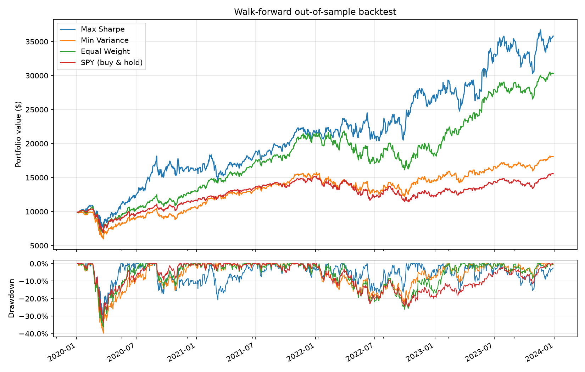
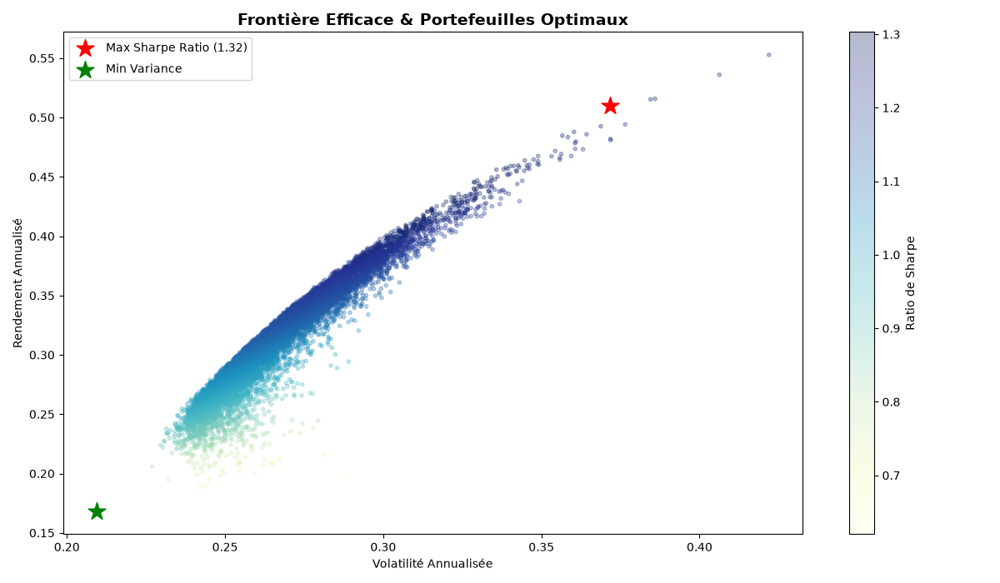
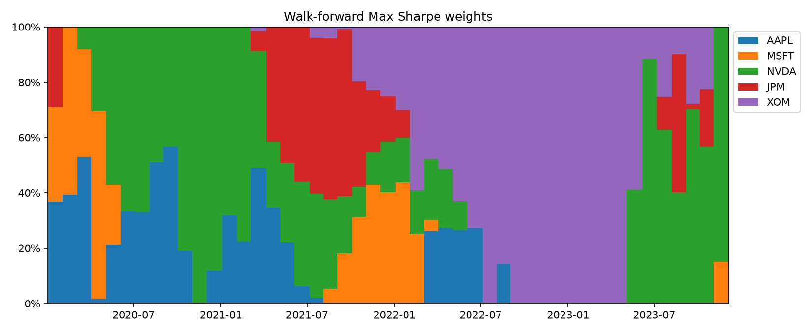

# MarketLens

[](https://github.com/Areejtiss/Marketlens/actions/workflows/ci.yml)
[](LICENSE)

A Python pipeline for mean-variance portfolio construction on daily equity data: data cleaning, risk metrics, long-only Markowitz optimization, and out-of-sample backtesting with transaction costs and walk-forward re-optimization.

Universe: AAPL, MSFT, NVDA, JPM, XOM (2019-2023, daily adjusted closes). SPY is used **only as a benchmark**.

## What it does

| Module | Contents |
| --- | --- |
| [`returns.py`](src/marketlens/returns.py) | Price extraction from yfinance output, cleaning (duplicates, non-positive prices, gap filling), simple/log/cumulative returns, rolling volatility |
| [`risk_metrics.py`](src/marketlens/risk_metrics.py) | Annualized return and volatility, Sharpe, Sortino, historical VaR and CVaR, drawdowns, beta |
| [`portfolio.py`](src/marketlens/portfolio.py) | Long-only, fully invested max-Sharpe and minimum-variance portfolios (SciPy SLSQP), efficient frontier |
| [`backtest.py`](src/marketlens/backtest.py) | Day-by-day simulator with weight drift, periodic rebalancing and turnover-based transaction costs; rolling walk-forward backtest |
| [`visualizations.py`](src/marketlens/visualizations.py) | All report charts |
| [`main.py`](main.py) | Runs everything and writes figures/CSVs to [`reports/figures`](reports/figures) |

## Quick start

```bash
git clone https://github.com/Areejtiss/Marketlens.git
cd Marketlens
python -m venv .venv && source .venv/bin/activate   # Windows: .venv\Scripts\activate
pip install -e ".[dev]"

pytest                 # unit tests
python main.py         # full pipeline on the committed price data
python main.py --refresh --cost-bps 5 --lookback 126 --rebalance 63   # re-download, change settings
```

## Methodology

**Static split.** Weights are estimated on the first 70% of the sample (Jan 2019 to Jun 2022) and held, rebalanced monthly, over the remaining 30% (Jul 2022 to Dec 2023).

**Walk-forward.** Every 21 trading days the optimizer is re-run using only the previous 252 days of returns, and the new weights are traded from that day on. The optimizer never sees data from the date it trades or later; a unit test checks this. The first year is used only for estimation, so the test covers Jan 2020 to Dec 2023.

**Costs.** Each rebalance pays 10 bps on traded notional (sum of absolute weight changes), including the initial purchase. Between rebalances, weights drift with prices.

**Baselines.** An equal-weight (1/N) portfolio of the same five stocks, rebalanced on the same schedule, and SPY buy-and-hold.

### Why SPY is not in the investable universe

An earlier version included SPY as a sixth asset, and the "Min Variance" portfolio ended up with ~95% SPY and returned exactly what SPY did. That is the expected behaviour, not a solver bug: SPY is a diversified index that already contains these stocks, with in-sample volatility of 22% against 31-52% for the individual names, so a long-only variance minimizer concentrates in it. Keeping the benchmark out of the universe makes the comparison meaningful. `tests/test_portfolio.py` reproduces the effect on synthetic data.

## Results

All numbers are produced by `python main.py` with default settings (10 bps costs, monthly rebalancing). Risk-free rate: 2%.

### Walk-forward, Jan 2020 to Dec 2023

| Strategy | Total return | CAGR | Volatility | Sharpe | Max drawdown | Annual turnover |
| --- | ---: | ---: | ---: | ---: | ---: | ---: |
| Max Sharpe | 258.0% | 37.7% | 34.1% | 1.05 | -29.8% | 4.72 |
| Min Variance | 80.8% | 16.0% | 27.4% | 0.61 | -40.1% | 1.97 |
| Equal Weight | 203.2% | 32.1% | 29.4% | 1.03 | -36.3% | 0.96 |
| SPY buy & hold | 55.7% | 11.7% | 22.6% | 0.52 | -33.7% | n/a |



### Static 70/30 split, Jul 2022 to Dec 2023

| Strategy | Total return | CAGR | Volatility | Sharpe | Max drawdown |
| --- | ---: | ---: | ---: | ---: | ---: |
| Max Sharpe | 74.7% | 45.0% | 28.8% | 1.37 | -24.7% |
| Min Variance | 42.1% | 26.4% | 20.2% | 1.16 | -15.6% |
| Equal Weight | 71.6% | 43.3% | 23.4% | 1.57 | -19.8% |
| SPY buy & hold | 27.8% | 17.8% | 17.2% | 0.92 | -16.7% |

In-sample weights (from [`05_optimal_weights.csv`](reports/figures/05_optimal_weights.csv)):

| | AAPL | MSFT | NVDA | JPM | XOM |
| --- | ---: | ---: | ---: | ---: | ---: |
| Max Sharpe | 69.9% | 0% | 25.2% | 0% | 4.8% |
| Min Variance | 11.7% | 44.8% | 0% | 15.4% | 28.1% |



### Takeaways

- **Equal weight is hard to beat.** On a risk-adjusted basis it matches Max Sharpe in the walk-forward test (Sharpe 1.03 vs 1.05) and beats it in the static test (1.57 vs 1.37), with a fifth of the turnover.
- **Max Sharpe weights are unstable.** Re-estimated monthly, the portfolio rotates from tech into JPM during 2021 and then almost entirely into XOM from mid-2022 to mid-2023 (see below). This is the well-known sensitivity of mean-variance optimization to estimated expected returns.
- **Min Variance did not deliver lower risk out of sample** in the walk-forward test: its drawdown (-40%) was the worst, largely from the March 2020 crash hitting a portfolio estimated on calm 2019 data.



## Limitations

- **Selection bias.** The five stocks were chosen knowing how they performed, and NVDA's run dominates the results. Absolute returns should not be read as an achievable edge; the comparison between methods is the point.
- **One sample.** A single five-year window with one regime change (2022). No confidence intervals or statistical tests on the Sharpe differences.
- **Simple cost model.** Linear costs on turnover; no spread, market impact, borrowing or taxes. Long-only, no leverage.
- **Sample estimates.** Plain historical mean and covariance, no shrinkage (e.g. Ledoit-Wolf) or robust return estimates, which would be the natural next step.

## Project layout

```
data/processed/cleaned_prices.csv   cleaned daily adjusted closes (input to main.py)
data/raw/raw_stock_data.csv         raw yfinance download
notebooks/                          exploratory notebooks (predate the benchmark fix; main.py is the reference)
reports/figures/                    generated charts and metric tables
src/marketlens/                     the package
tests/                              pytest suite (no network access needed)
```

## License

[MIT](LICENSE)
