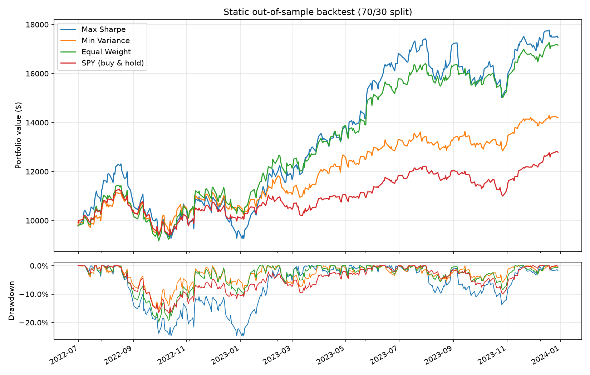

```markdown
# MarketLens 📈

[](https://www.python.org/downloads/)
[](LICENSE)
[](https://github.com/psf/black)

**MarketLens** est un pipeline d'ingénierie financière et d'analyse quantitative en Python. Le projet implémente la **Théorie Moderne du Portefeuille (MPT - Modern Portfolio Theory)** d'Harry Markowitz, enrichi par des simulations Monte Carlo vectorisées et un moteur de backtesting rigoureux sur données hors-échantillon (*Out-of-Sample*).

---

## 🎯 Aperçu du Projet

MarketLens permet d'automatiser l'intégralité de la chaîne de traitement quantitative :
1. **Ingestion & Nettoyage** de séries temporelles financières multi-actifs.
2. **Analyse Quantitative du Risque** (Volatilité, Value-at-Risk 95%, Max Drawdown, Ratio de Sharpe/Sortino).
3. **Optimisation MPT par Solver SLSQP** (Recherche sous contraintes des portefeuilles Tangent et de Variance Minimale).
4. **Simulation Monte Carlo Vectorisée** (Calcul de 10 000 portefeuilles via l'algèbre matricielle NumPy).
5. **Backtesting Chronologique Out-of-Sample (70/30)** pour éliminer les biais de sur-ajustement (*look-ahead bias*).

---

## 📊 Résultats Clés & Visualisations

### 1. Frontière Efficace & Simulation Monte Carlo
Optimisation des poids sur la période *In-Sample* (70% des données historiques). Le portefeuille **Max Sharpe** maximise le rendement ajusté au risque, tandis que le portefeuille **Min Variance** recherche la volatilité globale la plus faible.


### 2. Performance Out-of-Sample (Equity Curves)
Validation du modèle sur la période *Out-of-Sample* (30% des données historiques non vues lors de l'optimisation) avec un capital initial de **$10,000**, comparé au benchmark **SPY (S&P 500)** :



#### Tableau Récapitulatif des Performances (Out-of-Sample)

| Stratégie | Rendement Cumulé | CAGR | Volatilité Annualisée | Ratio de Sharpe | Max Drawdown |
| :--- | :---: | :---: | :---: | :---: | :---: |
| **Max Sharpe Portfolio** | **79.14%** | **47.50%** | 28.59% | **1.59** | -24.84% |
| **Min Variance Portfolio** | 29.02% | 18.52% | **17.04%** | 0.97 | **-16.27%** |
| **SPY Benchmark (S&P 500)** | 29.02% | 18.52% | 17.16% | 0.96 | -16.68% |

---

## 🛠️ Architecture du Projet

```text
MarketLens/
├── data/
│   ├── raw/                      # Captures de données brutes
│   └── processed/                # Séries temporelles nettoyées (cleaned_prices.csv)
├── notebooks/                    # Notebooks d'exploration pas-à-pas
│   ├── 01_data_ingestion.ipynb
│   ├── 02_eda.ipynb
│   ├── 03_risk_metrics.ipynb
│   ├── 04_portfolio_optimization.ipynb
│   └── 05_backtesting.ipynb
├── reports/
│   └── figures/                  # Figures (.png) et métriques (.csv) exportées
├── src/
│   └── marketlens/               # Package Python réutilisable
│       ├── __init__.py
│       ├── backtest.py           # Simulation de capital & statistiques de backtest
│       ├── data_loader.py        # Connecteurs Yahoo Finance & CSV
│       ├── portfolio.py         # Optimiseur SLSQP & simulations MPT
│       ├── returns.py           # Calculs de rendements simples et log
│       ├── risk_metrics.py      # VaR, Drawdown, Sharpe, Sortino
│       └── visualizations.py    # Génération de graphiques Matplotlib/Seaborn
├── main.py                       # Point d'entrée de l'exécution globale
├── pyproject.toml                # Configuration du package éditable (setuptools)
└── requirements.txt              # Dépendances du projet

```

---

## 🚀 Installation & Utilisation

### 1. Cloner le projet & préparer l'environnement

```bash
git clone [https://github.com/votre-username/Marketlens.git](https://github.com/votre-username/Marketlens.git)
cd Marketlens

# Création et activation de l'environnement virtuel
python -m venv .venv
source .venv/bin/activate  # Sur Windows: .\.venv\Scripts\activate

# Installation des dépendances et du package local en mode éditable
pip install -r requirements.txt
pip install -e .

```

### 2. Exécuter le pipeline complet (`main.py`)

Le script `main.py` automatise l'ensemble des modules (ingestion, calculs de rendement, optimisation MPT et backtest) :

```bash
python main.py

```

---

## 📐 Méthodologie Mathématique

* **Ratio de Sharpe** :

$$\text{Sharpe} = \frac{E[R_p] - R_f}{\sigma_p}$$


* **Volatilité du Portefeuille (Matrice de Covariance)** :

$$\sigma_p = \sqrt{w^T \Sigma w}$$


* **Optimisation sous contraintes (SLSQP)** :

$$\min_w \quad \frac{1}{2} w^T \Sigma w \quad \text{ou} \quad \max_w \quad \frac{w^T \mu - R_f}{\sqrt{w^T \Sigma w}}$$


$$\text{sujet à} \quad \sum w_i = 1 \quad \text{et} \quad 0 \le w_i \le 1 \quad (\forall i)$$


---

## 📜 Licence

Distribué sous la licence MIT. Voir `LICENSE` pour plus d'informations.

